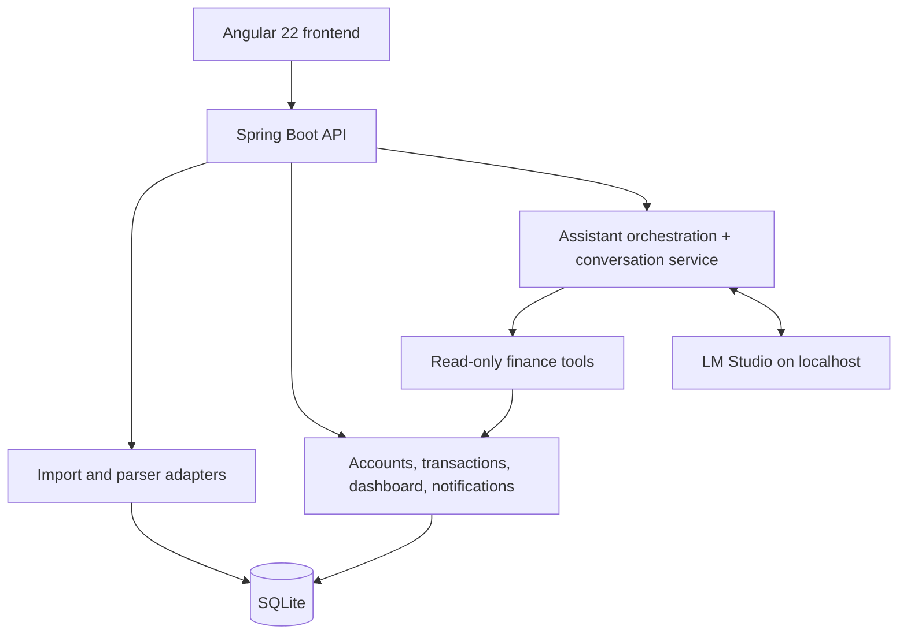

# System Architecture

## Overview



## Ownership boundaries

- **Frontend:** presentation, filters, review interactions, and Assistant transcript rendering.
- **Backend:** statement parsing, persistence, financial calculations, data validation, API contracts, AI tool authorization, and bounded conversation-context assembly.
- **SQLite:** local ledger, accounts, imports, transactions, category mappings, statement snapshots, and local Assistant conversations/messages/session context.
- **LM Studio:** interprets questions and explains tool results. It has no database or filesystem permission.

## Planned V7 ownership boundary

The current local installation is single-user. V7 will make the Finance Tracker a resource server behind the existing Auth Service and use the User Service's stable internal user ID as `owner_user_id` on every user-owned finance and Assistant record. Optional Plaid Items will be encrypted and owner-scoped; neither the browser nor an Assistant model will receive a Plaid access token. See the [V7 implementation plan](V7_AUTH_AND_PLAID_IMPLEMENTATION_PLAN.md).

## Data lifecycle

```text
Statement file → parser adapter → normalized transaction/statement fields
→ account match → duplicate and transfer detection → category/review state
→ confirmed local ledger → dashboard/accounts/notifications/assistant tools
```

## Related documents

- [Request flows](REQUEST_FLOWS.md)
- [Design decisions](DESIGN_DECISIONS.md)
- [Detailed AI Assistant Architecture](AI_ASSISTANT_ARCHITECTURE.md)
