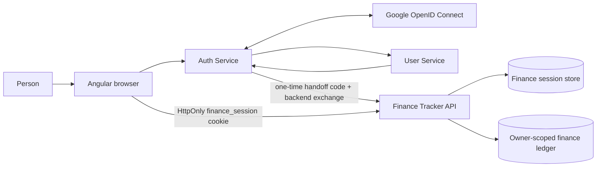
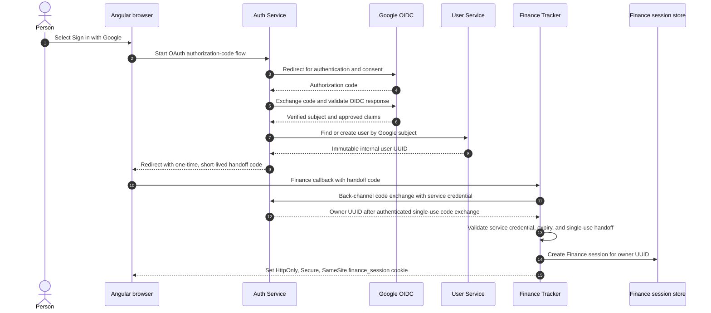
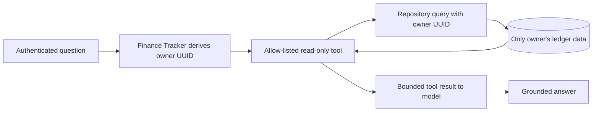

# V7 — Finance Tracker Authentication, Authorization, and Session Design

**Status:** in progress. Owner-scoped data, Auth Service handoff, Finance server-side sessions, browser sign-in/sign-out, CSRF enforcement, CORS restriction, expiry cleanup, and cross-user isolation tests are implemented. Production-grade signed service assertions and coordinated upstream logout remain.

## Purpose

This document explains how V7 will authenticate a person, authorize every Finance Tracker request, maintain a browser session, and prevent one signed-in person from accessing another person's financial data.

It is intentionally separate from the broader [V7 Auth and Plaid implementation plan](V7_AUTH_AND_PLAID_IMPLEMENTATION_PLAN.md). That plan describes the delivery work; this document describes the runtime security model engineers will build and verify.

## Security goals

- A person signs in once through Google; Finance Tracker never handles their Google password.
- Every Finance Tracker request has an authenticated application user.
- Every account, transaction, statement, import, Assistant conversation, notification, preference, and future Plaid Item belongs to exactly one internal owner.
- The browser cannot select or override an `owner_user_id`.
- A model tool executes only within the same authenticated owner boundary.
- A logout, expired session, revoked credential, or failed validation stops access safely.
- Tokens, session IDs, Plaid secrets, raw statement contents, and transaction content never appear in logs.

## Implemented foundation

The current application has an authenticated ownership foundation:

- `accounts`, statement imports, transactions, category rules, and assistant conversations persist an `owner_user_id`.
- A request-scoped `FinanceOwnerContext` is established by a server filter; it never accepts an owner ID from a browser request.
- Account lookup, account matching, account creation, card-term updates, transaction listing/edits, import history/review, transfer linking, remembered merchant-category rules, dashboard analytics, recurring detection, Assistant conversation history, and the Assistant's corresponding read-only tools already use that context and scope their queries by owner.

The completed one-time conversion assigned the former local ledger to the verified internal User Service ID without re-importing statements. Its bootstrap table and runtime claim code have been removed. Authentication is now mandatory: the owner filter accepts only a verified Finance session, and each new record receives the owner from that session.

Account matching is owner-scoped too. Its internal technical identity is stored as `owner_user_id|institution|last_four`, so two users may safely have accounts with the same bank and visible last four digits without a global uniqueness collision.

## Terms

- **Authentication:** proving who the person is.
- **Authorization:** deciding what the authenticated person may access or change.
- **Google subject:** Google's durable OpenID Connect identifier for the person. It is not an application database key.
- **Internal user ID:** immutable UUID issued by User Service. This becomes Finance Tracker's `owner_user_id`.
- **Session:** server-side state representing an active signed-in browser.
- **Access token:** short-lived signed credential issued for an API audience.
- **Resource server:** an API that validates credentials and protects data. Finance Tracker is the resource server.

## Recommended V7 model

V7 uses a backend-for-frontend style session boundary for the browser. The browser holds only an opaque, HttpOnly session cookie. It does **not** store a Google ID token, Finance access token, Plaid secret, or user ID in `localStorage`.

The Auth Service still uses Google OpenID Connect for login. After it maps the Google identity to the internal User Service ID, it issues a short-lived, single-use handoff code. Finance Tracker exchanges that code on its backend channel using a service credential, creates its own server-side session, and sets an opaque Finance cookie.



### Why this model

It keeps browser-held credentials small and non-readable by JavaScript, keeps Finance Tracker independent from raw Google tokens, and gives Finance Tracker a direct way to revoke/expire sessions. A signed, audience-restricted internal access token can still be used on the Auth Service-to-Finance Tracker backend handoff or between services; it is not exposed as a general browser API token.

## Identity and credential chain



### Current local handoff and production assertion target

The current local development implementation deliberately uses a single-use code (two-minute lifetime, consumed on exchange) plus a shared service credential in the Auth Service → Finance Tracker backend call. The browser receives only the code, never the internal owner ID or service credential. This is appropriate for the local three-service development environment, but it is not the final production transport security model: production must use HTTPS and either mutually authenticated service communication or a signed assertion validated against an Auth Service key set.

The following are the required claims for that production signed assertion:

The Auth Service to Finance Tracker assertion must contain only the identity/authorization information Finance Tracker needs:

- `iss`: Auth Service issuer identifier.
- `aud`: `finance-tracker-api`, preventing another service's credential from being accepted.
- `sub`: immutable internal User Service UUID, not email or Google subject.
- `exp`, `iat`, and optionally `nbf`: short validity period and issuance timing.
- `jti`: unique identifier used to detect replay/revocation where needed.
- `scope` or authorities: small allow-list such as `finance:read` and `finance:write`.
- `sid`: optional upstream session reference for coordinated logout.

Finance Tracker rejects the handoff if any required claim is missing or wrong. It must not accept an arbitrary self-declared user ID, an unsigned token, an expired credential, or a Google ID token whose audience is not Finance Tracker.

## How a normal request is authenticated and authorized

```mermaid
sequenceDiagram
    actor P as Person
    participant B as Angular browser
    participant F as Finance Tracker filter chain
    participant S as Session store
    participant C as Controller/service
    participant R as Owner-scoped repository
    participant D as Finance database

    P->>B: View an account or submit a finance action
    B->>F: HTTPS request + finance_session cookie
    F->>S: Load session by opaque random session ID
    S-->>F: owner UUID, expiry, scopes, CSRF/session state
    F->>F: Check expiry, revocation, request method, and CSRF when required
    F->>C: Attach authenticated principal; never accept owner ID from request body
    C->>R: Call operation with authenticated owner UUID
    R->>D: SELECT/UPDATE ... WHERE owner_user_id = :ownerUuid
    D-->>R: Only matching owner's rows
    R-->>C: Authorized result
    C-->>B: Response
```

### Request decisions

1. **No cookie or unknown session:** return `401 Unauthorized`.
2. **Expired/revoked session:** invalidate the local cookie and return `401`; UI sends the person to sign in again.
3. **Valid session but insufficient scope:** return `403 Forbidden`.
4. **Valid session, but requested record belongs to a different owner:** return `404` for object lookups where non-disclosure is preferred, or `403` when the API intentionally exposes that a forbidden operation was attempted.
5. **Valid session and record belongs to that owner:** perform the operation.

The browser may send an account ID, transaction ID, or import ID, but it never sends a trusted owner ID. The repository query applies `owner_user_id` itself. This prevents insecure direct-object-reference failures such as changing `/api/accounts/123` to another identifier.

## Session lifecycle

### Creation

- Finance Tracker creates a cryptographically random opaque session ID only after validating the one-time Auth Service handoff.
- The current local session record lives in the private Finance SQLite store and contains the internal owner UUID, creation time, last-seen time, absolute expiry, and a cryptographically random CSRF token. A production deployment can move this table to Redis or a shared database without changing the browser contract.
- The browser receives only the random session ID in an `HttpOnly`, `Secure`, `SameSite=Lax` cookie. For production, use HTTPS and a narrowly scoped domain/path. Local development may relax `Secure` only in an explicit local profile.
- The Angular browser client enables `withCredentials` only for Finance Tracker API calls. It never sends an application user ID or bearer token from browser storage. The sign-in control is shown whenever the Finance session is absent or expired.
- The profile menu reads a separate authenticated Auth Service profile projection containing only display name, email, and optional avatar. It does not receive a Google subject, internal user ID, roles, or Finance session material.

### Use and renewal

- Finance Tracker checks the session on every request.
- The implemented policy is a 30-minute idle timeout and an 8-hour absolute maximum. `last_seen_at` is touched at most every five minutes to avoid a database write on every request, and a scheduled task deletes expired or idle sessions every fifteen minutes.
- Renewal happens server-side only after rechecking upstream authentication or an approved refresh path. JavaScript does not receive a long-lived refresh token.
- Session identifiers rotate after login, privilege changes, and other authentication-boundary events to reduce session-fixation risk.

### Logout and revocation

- Logout deletes the Finance session from the session store, clears the cookie, and coordinates with Auth Service through `sid` or a logout endpoint.
- Auth Service logout invalidates its Redis session as well as its cookie.
- Password/security events, explicit revocation, or user deletion invalidate matching Finance sessions.
- A disconnected Plaid Item revokes only the Plaid connection; it does not log the person out.

## Authorization layers

Authorization is not a single controller annotation. V7 applies several layers:

```text
Valid session
  → endpoint scope check
    → authenticated owner context
      → service-level ownership decision
        → repository WHERE owner_user_id predicate
          → result/tool response
```

- **Endpoint scope:** for example, only an authenticated `finance:write` user may import a statement or save a category rule.
- **Service layer:** applies business rules, such as whether a person may disconnect their own Plaid Item.
- **Repository layer:** enforces tenant ownership in database reads and writes.
- **Assistant tool layer:** tools inherit the authenticated principal and cannot take an arbitrary `ownerUserId` argument from the model.

## Assistant and AI safety boundary



The LLM never sees a session ID, credential, Plaid access token, raw database, or another owner's data. Even if a question asks for another person's information, the tool query is already restricted before any result can be created.

## Service-to-service security

- Auth Service calls User Service with a service identity, such as OAuth client credentials or workload/mTLS identity.
- Finance Tracker validates Auth Service handoffs with signed assertions and trusted signing keys/JWKS, or a mutually authenticated back-channel introspection endpoint.
- User Service APIs are not publicly callable merely because they are internal in intent.
- Each service receives only the minimum scopes it needs. Finance Tracker does not need authority to assign User Service roles.
- Key rotation, issuer configuration, service URLs, and secrets are environment configuration—not source code or browser values.

## Browser protections

- Use HTTPS in non-local environments.
- Mark session cookies `HttpOnly`, `Secure`, and an appropriate `SameSite` value.
- State-changing cookie-authenticated endpoints require a synchronizer token in `X-Finance-CSRF`. Finance Tracker returns this token only to an authenticated same-origin Angular session-status request; Angular keeps it in memory and attaches it only to unsafe Finance API calls. Missing or invalid tokens are rejected with `403`.
- CORS permits credentials only for the configured Angular origin (`FINANCE_CORS_ALLOWED_ORIGIN`, default `http://localhost:4200`), exposes only the required request headers, and rejects other origins. It never uses wildcard origins with credentialed requests.
- Avoid `localStorage` for access/refresh tokens and avoid exposing internal user IDs as an authorization mechanism.

## Observability without financial-data leakage

Allowed operational logs include a request/correlation ID, endpoint, response class, session-validation outcome, anonymous owner hash where necessary, and error code. Logs must exclude:

- authentication headers, cookies, session IDs, token assertions, signing keys, Plaid secrets, and CSRF tokens;
- raw assistant questions/answers and tool payloads;
- statement files, transaction descriptions, balances, account numbers, email addresses, Google subjects, and roles.

Audit events are separate from debug logs: successful/failed login, session revocation, Plaid Link/exchange/disconnect, and denied authorization attempts should record safe metadata and correlation IDs only.

## Verification

- `FinanceSecurityIntegrationTest` creates two owners with separate sessions and proves that owner A cannot read owner B's import or Assistant conversation, cannot mutate owner B's transaction, and cannot see owner B's account. It also proves two owners can independently create accounts with the same bank/last-four identity.
- The same suite proves missing CSRF tokens are rejected, valid tokens permit a mutation and logout, expired sessions receive `401` and are purged, and only the configured browser origin passes CORS preflight.
- Expired, malformed, wrong-issuer, wrong-audience, replayed, and revoked credentials are rejected.
- Finance logout invalidates the server-side Finance session. Coordinated upstream Auth logout remains a follow-up.
- Browser JavaScript cannot read the Finance session cookie.
- User Service outage prevents a new login/handoff from issuing a Finance session.
- Assistant tools return only the authenticated owner's results.
- Logs contain none of the prohibited secrets or financial content.

## Industry alignment

This design uses standard OAuth/OIDC responsibilities: an identity provider authenticates the person, an authorization server issues credentials, and a resource server validates them before serving protected data. The design applies least privilege, deny-by-default authorization, and server-enforced ownership. References:

- [OpenID Connect Core](https://openid.net/specs/openid-connect-core-1_0.html)
- [RFC 9068 — JWT Profile for OAuth 2.0 Access Tokens](https://datatracker.ietf.org/doc/html/rfc9068)
- [RFC 9700 — OAuth 2.0 Security Best Current Practice](https://datatracker.ietf.org/doc/html/rfc9700)
- [OWASP Authorization Cheat Sheet](https://cheatsheetseries.owasp.org/cheatsheets/Authorization_Cheat_Sheet.html)
- [OWASP CSRF Prevention Cheat Sheet](https://cheatsheetseries.owasp.org/cheatsheets/Cross-Site_Request_Forgery_Prevention_Cheat_Sheet.html)

## Related documents

- [V7 Auth and Plaid implementation plan](V7_AUTH_AND_PLAID_IMPLEMENTATION_PLAN.md)
- [Architecture](ARCHITECTURE.md)
- [Request flows](REQUEST_FLOWS.md)
- [Design decisions](DESIGN_DECISIONS.md)
- [Auth Service → Finance Tracker integration](../../java/auth-service/docs/FINANCE_TRACKER_INTEGRATION.md)
- [User Service identity contract](../../java/user-service/docs/FINANCE_TRACKER_IDENTITY_CONTRACT.md)
