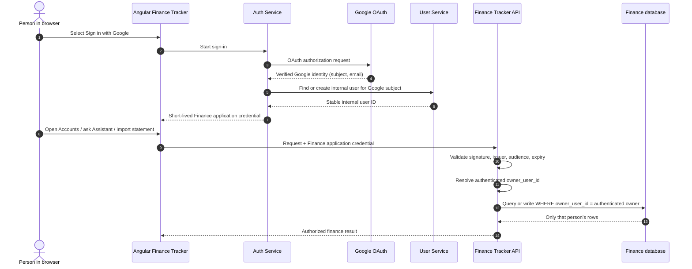
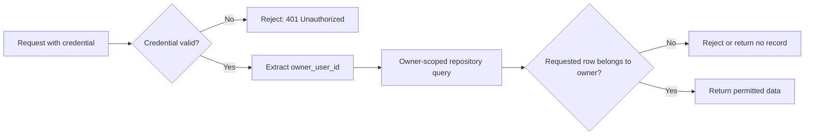
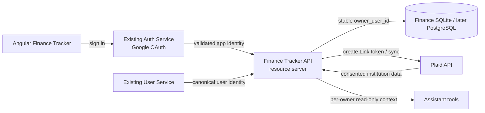
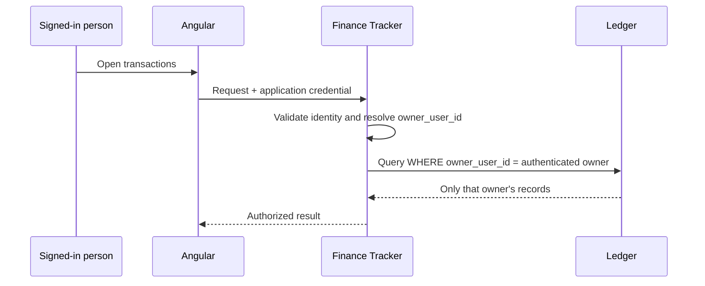
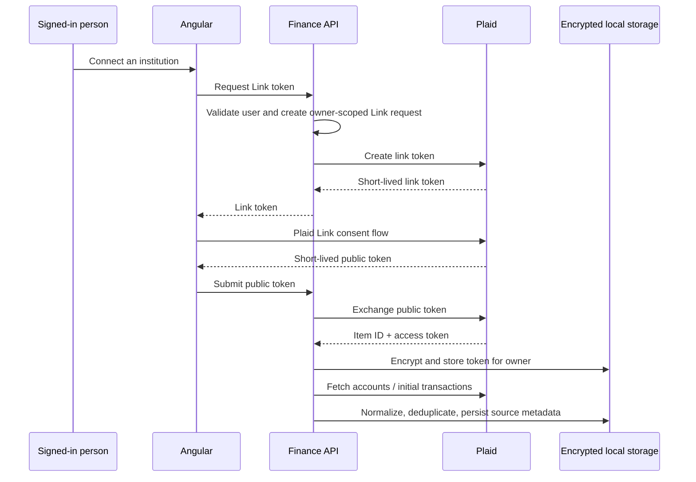

# V7 — Authenticated, Multi-User Finance and Plaid Connections

**Status:** in progress. Identity hardening, mandatory Finance authentication, owner-scoped ledger access, browser session controls, CSRF/CORS hardening, session expiry cleanup, and cross-user isolation tests are implemented. Plaid remains planned.

## Current implementation progress

- **Complete:** Auth Service and User Service identity hardening foundation, including internal User Service authentication, OAuth provisioning safety, session invalidation, CSRF enablement, and identity-log redaction.
- **Complete:** Finance Tracker ownership boundary. The database and user-facing finance flows persist and enforce `owner_user_id` derived only from a verified Finance session. The existing local ledger has been assigned to its verified internal user, and the one-time bootstrap code has been removed.
- **Complete:** Browser session hardening. Unsafe Finance API calls require a session-bound CSRF token; credentialed CORS is restricted to the configured Angular origin; Finance sessions expire after 30 idle minutes or 8 hours absolute and are cleaned up on a schedule. Integration tests prove two owners cannot access or mutate one another's records.
- **Planned next:** Plaid Link, encrypted Item storage, and sync/reconciliation flows.

## Goal

V7 makes the tracker safe to use as more than one person's application and, only after that boundary exists, adds an optional Plaid connection flow. The result remains local-first for the tracker database, while making the external-data boundary explicit and reversible.

```text
Google identity → authenticated Finance Tracker request → one owner's finance data
                                                 ↓
                                   optional consented Plaid connection
```

This is not a requirement to connect every account. Statement upload remains a first-class path and will continue to work for a user who never enables Plaid.

## Why authentication comes before Plaid

Today, the application is intentionally single-user: all accounts, statements, transactions, Assistant conversations, and future preferences share one local SQLite database. A Plaid access token is sensitive and must always belong to exactly one authenticated owner. Adding Plaid first would create an unsafe ownership gap.

V7 therefore delivers two layers in order:

1. **Identity and tenant isolation** — every finance record is owned and every request is authorized.
2. **Optional connected-account sync** — a consented Plaid Item belongs to that owner, is stored securely, and can be disconnected.

## Reusing the existing Auth and User services

The existing `auth-service` and `user-service` are useful foundations rather than systems to copy into this repository:

- **Auth Service** should continue to own Google OAuth sign-in and the authenticated browser session or application token.
- **User Service** should remain the canonical source for a stable internal user identifier and basic profile/role data.
- **Finance Tracker** becomes a resource server. It trusts a validated application identity, uses the stable internal user ID as `owner_user_id`, and never needs to exchange a Google authorization code itself.

Before wiring them into finance data, the shared services need a focused security-hardening pass:

- define an application token/session contract with issuer, audience, expiry, and signature validation; do not make a raw Google ID token the Finance Tracker's long-term authorization contract;
- restrict User Service APIs to authenticated callers or trusted service-to-service calls rather than broadly public endpoints;
- remove diagnostic logging/file writes that could expose Google identity or role data;
- decide and test CSRF/cookie behavior for browser requests;
- document logout, token expiry, and error behavior.

These are prerequisites, not cosmetic cleanup. The Finance Tracker must not turn on multi-user access until they are complete.

## How the services secure the Finance Tracker

The three services have deliberately different jobs. The Auth Service proves **who signed in** with Google. The User Service provides the application's stable internal identity. The Finance Tracker validates that identity on every request and uses it to limit every database query to one owner.



### Responsibility split

- **Google:** authenticates the human. It is not queried for every finance request.
- **Auth Service:** completes Google OAuth and issues the Finance Tracker's own short-lived credential/session. It must not pass an unvalidated raw Google ID token through as the application's authorization mechanism.
- **User Service:** maps the Google subject to a stable internal user ID. That ID is the durable ownership key, not the mutable email address.
- **Finance Tracker:** acts as a resource server. It validates the application credential locally, extracts the internal user ID, and applies it to every repository/service query.
- **Finance database:** stores `owner_user_id` alongside each user-owned record. It never determines ownership from a client-supplied query parameter.

### What prevents cross-user access



The frontend does not decide who a user is, and the Finance API does not trust an `ownerUserId` received from the browser. The server derives it only from the validated credential. The same owner boundary applies to imports, accounts, transactions, Assistant conversations, notifications, saved preferences, and future Plaid connections.

## Target architecture



The model boundary does not change: the Assistant receives only allow-listed tool results for the authenticated owner. It never receives a Plaid access token, raw statement files, another user's data, or direct database access.

## Ownership model and migration

Every user-owned table gains a non-null `owner_user_id` once V7 is enabled. The initial scope includes:

- accounts and statement snapshots;
- transactions, imports, category rules, and watched-folder settings;
- Assistant conversations/messages and future explicit preferences;
- notifications, recurring-activity state, and Plaid Items/sync records.

The migration is deliberately two-stage:

1. Add nullable ownership columns and backfill existing local records to the first signed-in owner's stable User Service ID.
2. After backfill verification, make ownership non-null and require the authenticated identity on every query and mutation.

Repository methods should accept `ownerUserId` explicitly. Relying on a UI filter or a controller-only check is not sufficient; the data-access layer must apply ownership predicates as well.



## Plaid design

### Scope

Plaid is optional account aggregation, not a replacement for statement parsing. V7's initial connected-data scope is:

- launch Plaid Link for an authenticated owner;
- exchange the short-lived public token only in the backend;
- store the Plaid Item/access token encrypted at rest, scoped to the owner;
- read account identity, balances, and Transactions data;
- normalize Plaid records into the same account/transaction model used by statement imports;
- show sync status, source, and last successful sync;
- permit disconnect, including calling Plaid's Item-removal endpoint and deleting local secrets.

The Finance Tracker never asks the browser to retain or send a Plaid access token. The browser sees only a short-lived Link token and a non-sensitive connection status.

### Connection lifecycle



### Sync and data integrity

Plaid transactions and statement-import transactions can describe the same real-world event. Each normalized transaction needs a source identity and provenance (`STATEMENT` or `PLAID`) so that duplicate detection can safely merge or link records instead of double-counting.

Initial V7 behavior should prefer conservative review over guessing:

- create/update an account only inside the authenticated owner's data partition;
- use Plaid account/item IDs as source identifiers, not account display name alone;
- retain source-specific transaction IDs and pending/posted state;
- deduplicate against both source IDs and normalized amount/date/merchant signals;
- show a review state when a source collision is uncertain;
- never overwrite statement-derived terms (APR, due date, statement period) unless the source and field authority are explicitly defined.

Plaid's `/transactions/sync` cursor is the preferred incremental sync mechanism. A scheduled job can later run per active Item, but V7 begins with explicit sync plus a visible last-sync result. Background automation comes only after failures, rate limits, reauthorization, and duplicate behavior are observable.

## Security and privacy controls

- Keep Plaid client ID, secret, access tokens, encryption keys, and application signing keys in environment/secret storage—never in Git, SQLite plaintext, browser storage, logs, or Assistant context.
- Encrypt the access token before persistence using an application-managed key; plan key rotation before production deployment.
- Log operational IDs/statuses only. Never log authorization headers, access tokens, raw institution payloads, balances, or transaction descriptions.
- Add a clear consent screen explaining Plaid is an external provider and that the user can disconnect it.
- On disconnect, call the appropriate Plaid Item-removal operation, delete local encrypted material, stop sync, and retain only minimal non-sensitive audit metadata where legally/operationally justified.
- Treat reauthentication (`ITEM_LOGIN_REQUIRED` or equivalent) as a user-visible action, never as a silent retry loop.
- Apply rate limits and audit events to Link creation, token exchange, sync, and disconnect endpoints.

## Implementation work breakdown

The following is the implementation checklist for V7. It is deliberately ordered: no Plaid production connection is built until the preceding identity and isolation work is accepted.

### 1. Harden the shared identity services

- Protect every User Service API with authenticated service-to-service access; no public `/api/**` user endpoints.
- Remove diagnostic file writes and any logging of Google subject IDs, email addresses, roles, credentials, or raw errors containing identity details.
- Require successful User Service provisioning/lookup before completing an Auth Service login or issuing a Finance credential.
- Make first-login user creation concurrency-safe with a database-backed upsert or a unique-constraint recovery/re-read flow.
- Invalidate both the browser credential and server-side Redis/Spring session at logout.
- Define a single documented Finance credential/session expiry and refresh policy.
- Protect cookie-authenticated browser mutations with an explicit CSRF approach.
- Replace broad user payloads with a minimal internal identity DTO.
- Add tests for provisioning failure, concurrent first login, logout invalidation, email changes, session expiry, and User Service timeouts.

### 2. Establish the Auth Service to Finance Tracker contract

- Have Auth Service mint a short-lived application credential after successful Google authentication.
- Include a stable internal user ID, issuer, audience, expiry, and only the scopes Finance Tracker needs.
- Publish the validation key/JWKS or use a deliberately designed secure session-validation path.
- Configure Finance Tracker as a resource server that validates the credential before controller logic runs.
- Never use a raw Google ID token or browser-supplied `ownerUserId` as the authorization contract.
- Add Angular sign-in, sign-out, expired-session, unauthenticated, and loading states.

### 3. Isolate every Finance Tracker record by owner

- Add `owner_user_id` ownership to accounts, snapshots, transactions, imports, category mappings, watched-folder settings, notifications, recurring state, Assistant conversations/messages, and future preferences/Plaid data.
- Backfill the existing local ledger to the first authenticated user's stable internal ID, verify totals and counts, then make ownership required.
- Pass `ownerUserId` explicitly through repositories and services; enforce it in data queries and mutations rather than only in Angular or controllers.
- Scope all Assistant tools and conversation retrieval to the authenticated owner.
- Prove through integration tests that user A cannot read, create, update, import into, or query through the Assistant any user B data.

### 4. Build Plaid against Sandbox

- Create a Plaid Trial team and use Sandbox credentials first.
- Create authenticated, owner-scoped Link-token and public-token exchange endpoints.
- Exchange the public token only in Finance Tracker; the browser never sees a Plaid access token.
- Encrypt persisted Plaid access tokens and store Item/account identifiers and sync state against the owner.
- Normalize Plaid accounts, balances, pending/posted transactions, and source IDs into the existing ledger model.
- Record provenance as `PLAID` or `STATEMENT`; conservatively deduplicate cross-source records and route uncertain matches for review.
- Implement manual sync, visible last-sync status, safe errors, reauthorization handling, and explicit disconnect.
- Test idempotent sync, expired consent, invalid credentials, duplicate events, and redacted logging.

### 5. Roll out real connections carefully

- Enable production Link only after the identity, isolation, and Sandbox acceptance checks pass.
- Connect one institution at a time and reconcile imported balances/transactions against saved statements.
- Keep PDF/CSV and watched-folder statement imports available without Plaid.
- Add operational audit events, endpoint rate limits, secret-management setup, and user-facing consent/disconnect documentation.
- Decide whether scheduled sync is useful only after manual sync, error recovery, and duplicate behavior are proven.

### Delivery sequence

#### Phase A — identity contract and tracker isolation

1. Document the Auth Service → Finance Tracker credential contract and run a security review of both shared services.
2. Add Finance Tracker authentication middleware/resource-server validation.
3. Add `owner_user_id` migrations and backfill the existing local ledger to the initial owner.
4. Thread the owner through repositories, services, watched imports, Assistant tools, conversations, preferences, and notifications.
5. Add Angular sign-in/out and unauthenticated/loading states.
6. Prove isolation with integration tests: user A cannot enumerate, read, update, import into, or ask the Assistant about user B's records.

#### Phase B — Plaid sandbox

1. Create a Plaid Trial team and develop against Sandbox first.
2. Implement owner-scoped Link-token creation, public-token exchange, encrypted Item storage, and explicit disconnect.
3. Import Sandbox accounts/transactions into a dedicated test owner and validate idempotent sync.
4. Exercise expired consent, invalid credentials, duplicate events, and safe log handling.

#### Phase C — controlled real connections

1. Enable real Link only after Phase A/B acceptance criteria pass.
2. Connect one institution at a time and compare normalized results against existing statement imports.
3. Add a visible sync history and actionable errors.
4. Decide whether scheduled sync is warranted after actual manual-sync observations.

## Definition of done

V7 is complete only when:

- every user-owned finance, Assistant, and notification record is isolated by a validated owner identity;
- a first-user migration preserves the existing local ledger without silently losing or sharing data;
- automated tests cover authentication failure, cross-user denial, ownership propagation, and data migration;
- Plaid can be linked, synced, re-synced idempotently, displayed with source status, and disconnected securely;
- token/key/financial-content log checks pass;
- statement imports remain usable without Plaid;
- documentation explains consent, privacy, current limits, operational setup, and recovery behavior.

## Deliberately deferred

- Multi-tenant cloud deployment and shared household accounts.
- Plaid-powered payments, transfers, or ACH initiation.
- Credit bureau data, credit-score integrations, and credit-report aggregation.
- Automatic background syncing before manual sync and error handling are proven.
- Mobile-specific authentication UX (V8).
- Durable preference memory beyond the already planned V10 boundary.

## Related documents

- [Architecture](ARCHITECTURE.md)
- [Request flows](REQUEST_FLOWS.md)
- [Design decisions](DESIGN_DECISIONS.md)
- [V9 persistent conversation memory](V9_PERSISTENT_AGENT_MEMORY_PLAN.md)
- [V10 explicit preferences](V10_EXPLICIT_MEMORY_PLAN.md)
